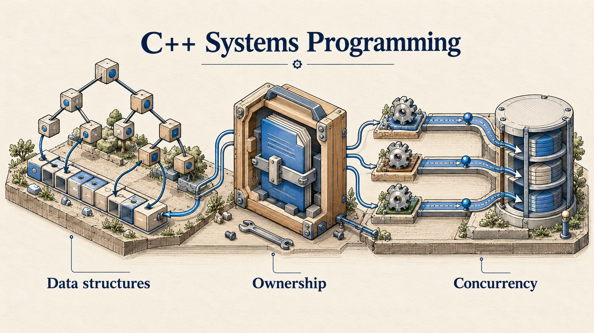

# C++ Systems Programming



*Conceptual illustration: data structures, resource ownership and concurrent access.*

**Data structures, memory, ownership and concurrency in C++20.**

[](https://github.com/kasra-mohebian/cpp-systems-programming/actions/workflows/ci.yml)
[](LICENSE)

A collection of small C++ implementations developed during completed individual coursework, then reviewed and adapted for this public portfolio. The focus is on how the pieces work: managing ownership with RAII, building containers, traversing expression trees and publishing immutable nodes between threads.

This is a learning project, not a replacement for the standard library. The public edition has its own build, tests and examples. Assignment questions, lecture material, instructor implementations and tests, and the original submission history are excluded. See [what changed for publication](docs/public-edition.md).

## Explore the code

| Area | Implementation | What to look at |
| --- | --- | --- |
| Algorithms | [Max heap](src/BinaryHeap.cpp), [pointer sorting](src/SortPointers.cpp) | Sift operations; quicksort partitioning; stable merge |
| Text and encoding | [Naive / KMP search](src/StringMatching.cpp), [Varint](src/Varint.cpp) | Prefix tables; seven-bit encoding; malformed-input handling |
| Disjoint sets | [Union-find](include/cppstudy/UnionFind.hpp) | Path compression and union by rank |
| Memory | [Object representation](src/ObjectRepresentation.cpp), [packed bits](src/BitSet.cpp) | Byte copying; IEEE-754 fields; proxy references and iterators |
| Containers | [Chaining hash table](src/ChainingHashTable.cpp) | Move-only values, rehashing and iterative chain destruction |
| Numbers | [Rational](src/Rational.cpp), [Complex](src/Complex.cpp) | Canonical fractions, checked integer arithmetic and value semantics |
| Expressions | [AST](src/AST.cpp), [print visitor](src/PrintVisitor.cpp) | Polymorphic nodes, `unique_ptr` ownership and constant folding |
| Resources | [Temporary directories](src/TempDirectory.cpp), [files](src/TempFile.cpp), [command dispatcher](src/CommandLine.cpp) | Shared parent lifetime, move semantics and cleanup |
| Execution | [Small register VM](src/SimpleVM.cpp) | Instruction dispatch, checked operands and integer wrap semantics |
| Concurrency | [Three multimaps](include/cppstudy/MultiMaps.hpp) | Sequential, mutex-protected and atomic append-only insertion |

A useful reading order is **heap → hash table → RAII → expression tree → atomic multimap**. [Design notes](docs/design.md) explain the trade-offs and boundaries of each module.

## Build and run

Requirements: Linux or macOS, CMake 3.20+, and a C++20 compiler (GCC or Clang). No downloaded libraries are required.

```sh
git clone https://github.com/kasra-mohebian/cpp-systems-programming.git
cd cpp-systems-programming
cmake -S . -B build -DCMAKE_BUILD_TYPE=Debug
cmake --build build --parallel
ctest --test-dir build --output-on-failure
./build/cppstudy_demo
```

The example produces:

```text
Heap, largest first: 9 7 3 1
1/3 + 1/6 = 1/2
KMP match offset = 8
Varint: 4 integers -> 7 bytes
VM Fibonacci(10) = 55
Concurrent inserts for key 7 = 2
```

For AddressSanitizer and UndefinedBehaviorSanitizer:

```sh
cmake -S . -B build-asan -DCMAKE_BUILD_TYPE=Debug -DCPPSTUDY_SANITIZERS=ON
cmake --build build-asan --parallel
ctest --test-dir build-asan --output-on-failure
```

## Validation

Seven independently written test suites cover algorithms, containers, numbers, expressions, the VM, resources and concurrency. Checks include comparisons with standard-library results, deterministic randomized inputs, move/cleanup lifetimes, malformed bytecode and Varints, and concurrent readers and writers. Tests remain active in Release builds.

CI runs Debug and Release builds on Linux and macOS (Intel), plus a Linux ASan/UBSan build. The concurrency tests check observed behavior; they are not a formal proof of correctness or a performance benchmark. CI also runs the concurrency suite under ThreadSanitizer on Linux. A separate local ThreadSanitizer build is available with `-DCPPSTUDY_THREAD_SANITIZER=ON` on supported systems.

## Boundaries

- This is a reviewed public adaptation, not an exact archive of the submitted solutions. [The publication notes](docs/public-edition.md) distinguish retained implementations from new adapters and fixes.
- The RAII module uses POSIX APIs. Use a fresh path under a private, controlled parent directory; it is not a filesystem security boundary against other processes changing paths.
- The atomic multimap is append-only. All readers and writers must finish before destruction; allocation and the platform's atomics may use locks.
- Pointer-sort ranges must belong to one array and contain valid pointers. Bit proxies and iterators follow the lifetime restrictions in [the design notes](docs/design.md).
- No coursework PDFs, participant datasets, personal contact information or university server details are included.

## Acknowledgements

I thank [Prof. Dr. Maximilian E. Schüle](https://www.uni-bamberg.de/dt/team/maximilian-e-schuele/) for his teaching and guidance in learning systems programming in C++.

## License

The code, documentation and original examples in this public edition are available under the [MIT License](LICENSE). Course materials and third-party teaching code are not included or licensed by this repository. This is a personal student portfolio, not an official university publication.
